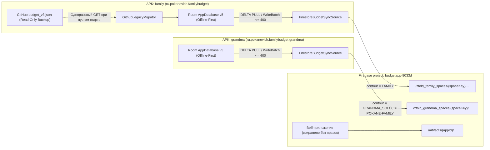

# Отчёт о ночном аудите, стабилизации и миграции Family Budget (Z Fold 4/5 Edition)

**Ветка:** `audit/overnight-hardening` (отведена от `main`, checkpoint-тег `checkpoint/pre-firebase-migration`)  
**Версия приложения:** `3.7.4` (`versionCode = 28`, Room `v4 → v5`)  
**Проверенные профили сборки:** `family` (`ru.pokanevich.familybudget`) и `grandma` (`ru.pokanevich.familybudget.grandma`)

---

## 1. Общая сводка и базовый срез (Baseline)

Перед внесением правок проект был индексирован через `/graphify` (`47` исходных файлов, `908` узлов, `2765` рёбер, `36` тематических кластеров). Ядро зависимостей сосредоточено в четырёх узлах: `ExpenseEntity` (`74` связи), `BudgetRepository` (`73`), `FamilyBudgetApp` (`57`) и `CategoryRegistry` (`52`).

- **Базовый прогон до правок:** `21` тестовый набор, `144` unit-теста, `0` падений; `lintDebug` имел `1` ошибку (`UnsafeOptInUsageError` в `QrScannerDialog`).
- **Итоговый прогон после всех этапов:** `29` тестовых наборов, **`176` unit-тестов** (`0` падений, `0` пропущенных) для каждого из двух flavor-вариантов (`testFamilyDebugUnitTest` и `testGrandmaDebugUnitTest`), чистый `lintFamilyDebug` / `lintGrandmaDebug`, успешная R8-минифицированная сборка `assembleFamilyRelease` и `assembleGrandmaRelease` с подтверждённой подписью APK Signature Scheme v2.

---

## 2. Исправление 3 приоритетных проблем с банковскими пушами и дублями (TDD)

### 2.1. Зависшие пуши MirPay — жёсткое правило ±5 минут
- **Корневая причина:** При зависании MirPay и отложенной выгрузке уведомлений через час и более Android/сервис опирался только на `sbn.postTime` в `onListenerConnected()`, не проверяя отложенную доставку при живом сервисе и не сверяя реальное время покупки внутри текста уведомления (например, `17.11.2026, 13:25`, когда `postTime` перерисовывается текущим временем).
- **Решение:**
  - Выделен `BankPushTimeValidator` (`MAX_ALLOWED_DRIFT_MS = 300_000L`, `MIN_VALID_EPOCH_MS = 1_577_836_800_000L`).
  - В `BankPushParser.extractOperationTimestampMs()` добавлено извлечение времени самой операции из текста/заголовка (поддерживаются `dd.MM.yyyy HH:mm`, `dd.MM.yy HH:mm`, ISO-форматы и время `HH:mm` с переходом через полночь).
  - В `BankPushListenerService.processStatusBarNotification()` проверяются **все три** источника времени (`sbn.postTime`, `notification.when`, `operationTimeMs`) до обращения к `BudgetRepository`: при отклонении `> 5 мин` в любую сторону пуш сразу отбрасывается и не попадает ни в Room, ни в `PendingPushDeck`.
  - Окно локального дедупа `BudgetRepository.SAME_DEVICE_DEDUP_WINDOW_MS` увеличено до `300_000L` (5 минут).
- **Покрытие:** `BankPushTimeValidatorTest`.

### 2.2. Двойные записи из пушей Сбера и актуальные шаблоны 2026 года
- **Корневая причина (подтверждена на реальной базе `budget_v3.json`):**
  1. Уведомления со сводным флагом `Notification.FLAG_GROUP_SUMMARY` повторно приносили текст последней покупки под новым `sbn.id`.
  2. Ключ `sbn.key|postTime` пробивался при перерисовке шторки Android, когда система обновляла `postTime`.
  3. Склейка `EXTRA_TEXT_LINES` в `InboxStyle` подмешивала предыдущие строки истории к новой операции.
  4. Актуальный шаблон Сбера (`"🎉 Оп! И оплачена покупка в Пятёрочка 1 034,33 ₽ — В запасе: ..."`) не отсекал хвост `"В запасе"`, а шаблон MirPay (`"Оплата покупки Сумма 767 ₽. 17.11.2026, 13:25. Карта Mir • • • • 3538"`) затягивал дату и маску карты в название магазина.
- **Решение:**
  - В `BankPushListenerService` отсекаются `Notification.FLAG_GROUP_SUMMARY`, при заполненном `primaryText` отключается слепая склейка `EXTRA_TEXT_LINES`.
  - Реализован `PushNotificationDeduplicator` с двойным ключом: слот шторки + SHA-256 отпечаток контента (`10 мин` TTL) с персистентным буфером до `100` записей в `FamilyPreferences.recentPushDedupKeys` — переживает перезапуск процесса.
  - В `BankPushParser` и `BudgetRepository.BALANCE_MARKER_REGEX` добавлены маркеры `"В запасе"` / `"запас средств"`, префиксное извлечение мерчанта перед суммой в современных пушах Сбера и отсечение даты/карты у MirPay.
- **Покрытие:** `PushNotificationDeduplicatorTest`, `BankPushParserTest`.

### 2.3. Общая карта («Я + Жена») — дедупликация с двух телефонов и Room v5
- **Корневая причина:** Два телефона получали пуши по одной и той же покупке общей карты, включая пары одного канала (`PUSH_SBER` ↔ `PUSH_SBER` у мужа и жены) с разными формулировками (обезличенное уведомление «Покупка по карте» и детальный чек «Пятёрочка») и одинаковым временем без идентификатора устройства-источника.
- **Решение:**
  - В `ExpenseEntity` добавлено поле `originDeviceId` (стабильный UUID установки в `FamilyPreferences.deviceInstallationId`) и 4 SQL-индекса Room (`isDeleted+isPendingConfirmation+createdAtEpochMs`, `isSynced`, `dedupSignature+createdAtEpochMs`, `splitGroupId`).
  - База переведена на **Room `v5`** со строгой ручной миграцией `MIGRATION_4_5`, без `fallbackToDestructiveMigration()`, с обновлённой схемой в `app/schemas/ru.pokanevich.familybudget.data.AppDatabase/5.json`.
  - В `BudgetRepository` окно кросс-девайсного слияния `CROSS_DEVICE_DEDUP_WINDOW_MS` настроено на `180_000L` (±3 минуты) с учётом копеек (`amountToKopecks`) и типа операции. Объединяются пары `PUSH_MIRPAY` ↔ `PUSH_*` и одноканальные `PUSH_<BANK>` ↔ `PUSH_<BANK>` с разных устройств/авторов (при двух generic-мерчантах сверяются последние 4 цифры карты или жёсткое окно `<= 60 сек`).
  - Функция `deduplicateCrossDevicePushExpensesWithEnrichment()` детерминированно выбирает победителя и **переносит недостающего мерчанта, категорию и заметку с проигравшей записи**, прежде чем мягко удалить дубль (`isDeleted = true`, `isSynced = false`).
- **Покрытие:** `AppDatabaseMigrationTest`, `CrossDevicePushDedupTest`, `ExpenseEntityJsonTest`.

---

## 3. Полный аудит кодовой базы и устранённые дефекты

| Критичность | Область / Файл | Обнаруженный дефект | Внесённое исправление |
| :--- | :--- | :--- | :--- |
| **CRITICAL** | `RecurringPaymentScheduler.kt`, `BudgetRepository.kt` | Метка `updatedAtEpochMs` при срабатывании автоплатежа брала `scheduledMs` без `nowMs`; свежий черновик с другого телефона в более позднем часовом поясе воскрешал удалённый платёж. | Добавлен `maxOf(nowMs, scheduledMs, payment.updatedAtEpochMs + 1L)` и `resolveRecurringConflict()` (anti-resurrection guard в merge engine). |
| **CRITICAL** | `QrScannerDialog.kt` | При закрытии диалога сканера `ProcessCameraProvider.unbindAll()` и `BarcodeScanner.close()` не вызывались — задняя камера оставалась открытой до ухода с `MainActivity`. | Трекинг ссылок провайдера/анализатора/сканера, атомарный флаг `isDisposed`, обязательное освобождение `clearAnalyzer()`, `unbindAll()`, `close()`, `executor.shutdown()` и обработка ошибок `ProcessCameraProvider`. |
| **CRITICAL** | `FamilySettingsSheet.kt`, `FamilyPreferences.kt` | Пустой код пространства при сохранении подставлял `"POKANE-FAMILY"` и `120000.0`, создавая риск утечки изолированной сборки в семейный бюджет. | Конфигурируемые флаги `IS_SPACE_CODE_LOCKED` и `DEFAULT_MONTHLY_BUDGET_RUB`; при блокировке кода поле в UI отключено и жёстко фиксирует целевой контур. |
| **HIGH** | `Formatters.kt`, `CsvExporter.kt` | `DecimalFormat` и `SimpleDateFormat` (непотокобезопасные в JDK) разделялись между UI Compose (`Main`) и фоновым обновлением виджета (`Dispatchers.IO`). | Все форматтеры чисел и дат переведены на `ThreadLocal.withInitial { ... }` (`FormattersThreadSafetyTest`). |
| **HIGH** | `MoneyMath.kt`, `AiBudgetAdvisor.kt`, `MonthlyTrendCalculator.kt`, `SavingsGoalCalculator.kt`, `SplitExpenseBuilder.kt`, `ExpenseFeedList.kt` | Суммирование вещественных чисел `Double` накапливало погрешность IEEE-754 в балансах, графиках и проверках сплита. | Введён `MoneyMath` с целочисленной арифметикой в копейках (`Long`) и хелпером `sumRubOf {}`. |
| **HIGH** | `MoneyManagerImporter.kt`, `BudgetRepository.kt` | Отсутствовал потолок распаковки `.mmbackup` (риск zip-бомбы); массовый импорт записывался вне единой транзакции. | Лимит `MAX_EXTRACT_BYTES = 100 МБ` при чтении ZIP-потока и пакетная запись `chunked(250)` внутри `db.withTransaction`. |
| **HIGH** | `BankPushListenerService.kt` | `serviceScope` не отменялся в `onDestroy()`, а системное отключение слушателя могло оборвать корутину до завершения записи в Room. | Добавлен `onDestroy()` с отменой `serviceScope`; запись перенесена в `BudgetRepository.enqueueBankNotification()` с `withContext(NonCancellable)`. |
| **HIGH** | `MainActivity.kt`, `AndroidManifest.xml`, `SecretVault.kt` | Не сохранялись открытые шторки при смене конфигурации Z Fold (`density`/`uiMode`/`fontScale`); отсутствовал `FLAG_SECURE` при PIN; ключи Gemini/токены лежали в открытом XML; логи с суммами/мерчантами писались в release. | Расширен `configChanges`, диалоги переведены на `rememberSaveable`, включён `FLAG_SECURE` при активном PIN/блокировке, создан `SecretVault` (AndroidKeyStore AES-256-GCM с прозрачной миграцией plaintext), логи ограничены `BuildConfig.DEBUG` без сумм и мерчантов. |
| **MEDIUM** | `FnsQrParser.kt` | URL-обёрнутые чеки ОФД (`https://...?t=...&s=...#...`) не парсились, не отфильтровывались `NaN`/`Infinity`, использовался локальный `SimpleDateFormat`. | Выделение query-параметров между `?` и `#`, проверка `isFinite()`, переход на потокобезопасный `DateTimeFormatter`. |

---

## 4. Миграция облачной синхронизации с GitHub на Firebase Cloud Firestore

Локальным источником правды (Offline-First) **по-прежнему остаётся Room (`AppDatabase`)**, а данные в историческом GitHub-репозитории `epokanevich/family-budget-sync-db` (`budget_v3.json`, `config_v1.json`) не удаляются и не перезаписываются. В коде не осталось ни одного `PUT`/`POST`/`DELETE`-запроса к GitHub API.

### Ключевые архитектурные детали
- **Проект и приложения Firebase:** в проекте `budgetapp-9033d` зарегистрированы два отдельных Android-приложения (`ru.pokanevich.familybudget` и `ru.pokanevich.familybudget.grandma`). Чтобы публичные CI-сборки не падали без `google-services.json`, конфиги исключены из Git через `.gitignore`, а `app/build.gradle.kts` читает параметры Firebase из локального `google-services.json` (или переменных окружения) и инициализирует именованный `FirebaseApp` программно. Использована версия `firebase-bom:33.1.2`, совместимая по метаданным модулей с Kotlin `1.9.23`.
- **Инкрементальная дельта-синхронизация и кэш:** `FirestoreBudgetSyncSource` работает в режиме `MemoryCacheSettings` (без дублирующего дискового SQLite от Firestore поверх Room), загружает только документы с `updatedAtEpochMs > watermark - 5000 ms`, отправляет изменения батчами до `400` операций и обновляет `isSynced`/`watermark` строго после подтверждения записи.
- **Realtime без лишнего расхода батареи:** `SnapshotListener` активен только когда UI находится в foreground (`MainActivity` в `ON_START..ON_STOP`) и мгновенно закрывается при уходе в фон.
- **Защита `SyncGuardException`:** сохранена проверка — при локальной истории синхронизированных операций и пустом первоначальном ответе Firestore синк прерывается с исключением вместо перезаписи данных.
- **Правила безопасности (`firestore.rules`) и оценка модели доверия:** правила для веб-приложения (`/artifacts/{appId}/...`) сохранены дословно и уже развёрнуты в `budgetapp-9033d`. Новые правила жёстко изолируют контуры `zfold_family_spaces` и `zfold_grandma_spaces`, запрещают `POKANE-FAMILY` для `grandma`, требуют членства в `/members/{uid}`, валидируют строгую схему полей, длины строк, монотонный `updatedAtEpochMs` и запрещают физическое удаление документов (`allow delete: if false;`).  
  > [!IMPORTANT]
  > **Ограничение прототипной модели доступа:** сейчас клиент использует **Firebase Anonymous Auth** в связке с общим кодом пространства `spaceKey` (capability-ключ). Секретный `spaceKey` не угадывается перебором при соблюдении правил, но любой, кто узнает `spaceKey` и подключится через клиент с конфигурацией проекта, сможет зарегистрировать свой анонимный `uid` в `/members/{uid}`. Для публичного распространения рекомендуется заменить анонимный вход на Google/Email Auth с фиксированным allowlist `uid` владельцев и включить Firebase App Check (Play Integrity).

---

## 5. Готовые APK-сборки (`build_outputs/`)

Оба релизных APK собраны с R8-минификацией, сжатием ресурсов и проверены через `apksigner verify` (APK Signature Scheme v2):

| Файл APK | `applicationId` | Имя на экране | Контур Firestore | Код пространства | Бюджет по умолчанию |
| :--- | :--- | :--- | :--- | :--- | :--- |
| `build_outputs/family-budget-family.apk` | `ru.pokanevich.familybudget` | **Семейный Бюджет** | `zfold_family_spaces` | `POKANE-FAMILY` (редактируемый) | `200 000 ₽` |
| `build_outputs/family-budget-grandma.apk` | `ru.pokanevich.familybudget.grandma` | **Мой Бюджет** | `zfold_grandma_spaces` | `GRANDMA-SOLO` (заблокирован) | `50 000 ₽` |

> [!TIP]
> **Установка на Android 13/14+ (Samsung Galaxy Z Fold 4/5 и др.):** после установки APK из файла или мессенджера система блокирует переключатель доступа к уведомлениям («Ограниченные настройки»). Чтобы включить автоучёт банковских пушей, откройте **Настройки Android → Приложения → Семейный Бюджет (или Мой Бюджет) → меню `⋮` в правом верхнем углу → Разрешить ограниченные настройки**, затем вернитесь в приложение и включите службу перехвата пушей. Оба приложения имеют разные `applicationId` и могут быть установлены параллельно на одном телефоне без конфликта.

---

## 6. Теоретическое продуктовое видение (БЕЗ реализации в коде)

> По условиям ночного аудита новые продуктовые функции и редизайн UI в код не вносились — ниже приведены концептуальные наблюдения и направления развития.

### 6.1. Для пары «Я + Жена» (Samsung Galaxy Z Fold 4/5)
- **Что кажется избыточным / шумом:**
  1. Дублирующиеся элементы переключения периодов и кнопки ИИ-чата в узких и широких состояниях создают визуальную плотность в верхней части аналитической панели.
  2. Постоянное отображение поля «Код семьи» и debug-лога пушей на видном месте в настройках: после первоначальной связки телефонов эти элементы нужны раз в год, их логично прятать в раздел «Диагностика».
- **Что стоит добавить в следующих версиях:**
  1. **Полноценный Dual-Pane Drag & Drop / Multi-Window для Z Fold:** перетаскивание входящего пуша из левой панели прямо на категорию или копилку в правой панели, а также опора на `WindowInfoTracker` (`FoldingFeature.State.HALF_OPENED` Flex Mode) для расположения графиков в верхней половине экрана и фильтров/калькулятора в нижней.
  2. **Явный статус «Общая карта vs Личная операция» и лента сверки:** в деталях транзакции полезен бейдж «Склеено с пушем Сбера/MirPay с 2-го телефона» с возможностью в один тап разъединить ошибочное совпадение (unmerge) на случай редких одномоментных одинаковых покупок.
  3. **Совместные подтверждения и уведомления о лимитах:** тихий локальный дайджест в 21:00 («Сегодня потрачено X ₽, до безопасного ритма осталось Y ₽») без спама по каждой транзакции.

### 6.2. Для «Бабушки» (Solo-режим, профиль `grandma`)
- **Что сейчас является когнитивной нагрузкой и лишним для пожилого пользователя:**
  1. Перегруженные экраны настроек и аналитики: кнопки вроде «Разделить чек на части», «Импорт архива Money Manager (.mmbackup)», выбор нескольких профилей/источников, а также сложные промпт-настройки Gemini API и смена кода семьи (последнее уже безопасно скрыто/заблокировано, но остальные инструменты переноса и тонкие графики трендов остаются в общем потоке).
  2. Наличие двухшаговой ручной разборки пушей (`PendingPushDeck`) при большом количестве уведомлений — пожилому человеку проще видеть крупную ленту уже учтённых трат с простым выбором «Изменить категорию», если автоматика ошиблась.
- **Что стоит добавить в будущих итерациях («Режим заботы / Senior UX»):**
  1. **Упрощённый главный экран с крупной типографикой:** три гигантские карточки сверху — *«Можно тратить сегодня»*, *«Потрачено за месяц»*, *«Осталось до пенсии / конца месяца»* — и одна заметная кнопка **«+ Записать покупку»** (либо голосовой ввод суммы и магазина через Android `SpeechRecognizer`, без мелкого калькулятора сплита).
  2. **Полуавтоматический авто-подхват:** включённый по умолчанию режим спокойного автоподтверждения пушей с понятным списком последних 5 покупок крупным шрифтом (от 18 sp) и высококонтрастными кнопками подтверждения/исправления.
  3. **Удалённый «Режим чтения» для семьи (опционально по явному согласию):** вместо смешивания в одну общую базу — безопасная отправка только агрегированной сводки («Баланс в норме, регулярные счета ЖКХ оплачены») без вторжения в личные чеки.
